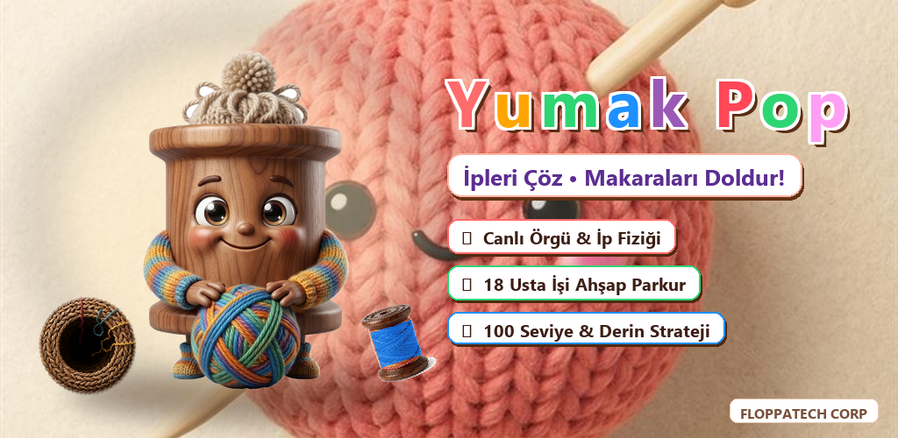
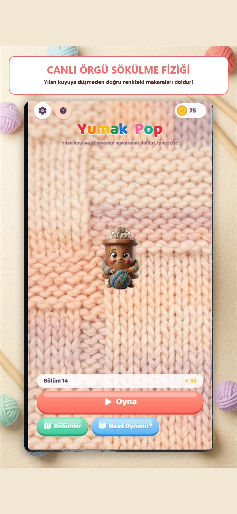
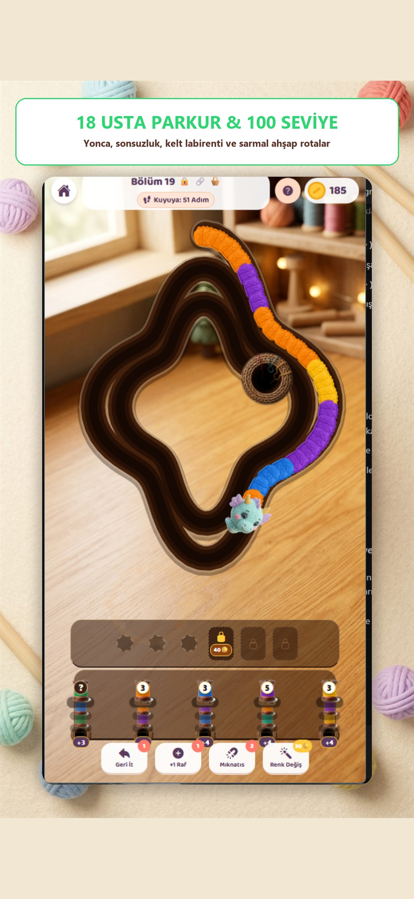
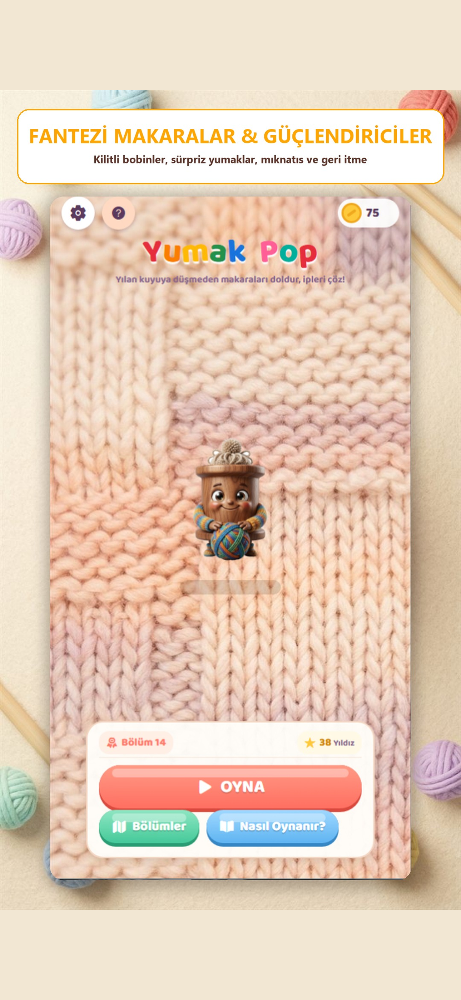
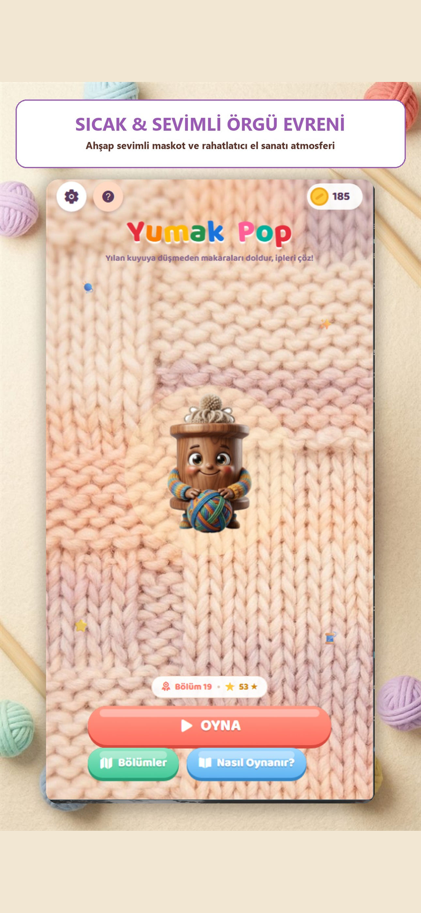

<div align="center">
  
  <h1>🧶 Yumak Pop – 3D Wool Puzzle & Yarn Match</h1>
  <p><strong>Kıvrımlı Örgü Yılanını Kuyuya Düşmeden Çöz! 100 Matematiksel Olarak Doğrulanmış Bölüm, 8 Yenilikçi Mekanik & Rahatlatıcı Cozy Craft Bulmaca Deneyimi</strong></p>
  <p>
    <a href="https://floppatechcorp.vercel.app/apps/yumak-pop">🌐 Ürün Vitrin Sayfası</a> •
    <a href="https://floppatechcorp.vercel.app/privacy/yumak-pop">🛡️ Gizlilik Politikası</a> •
    <a href="https://floppatechcorp.vercel.app/support#yumak-pop">💬 Destek Merkezi</a>
  </p>
  <p>
    
    
    
    
    
  </p>
</div>

---

## 📖 İçindekiler
- [🎯 Oyun Hakkında](#-oyun-hakkında)
- [✨ Temel Özellikler](#-temel-özellikler)
- [🧶 8 Yenilikçi Oyun Mekaniği](#-8-yenilikçi-oyun-mekaniği)
- [⚡ Taktiksel Güçlendiriciler](#-taktiksel-güçlendiriciler)
- [📐 Matematiksel Seviye Doğrulama (Zero-Deadlock)](#-matematiksel-seviye-doğrulama-zero-deadlock)
- [📱 Ekran Görüntüleri ve Görsel Vitrin](#-ekran-görüntüleri-ve-görsel-vitrin)
- [🏗️ Mimari ve Teknoloji Yığını](#️-mimari-ve-teknoloji-yığını)
- [📁 Proje Dizin Yapısı](#-proje-dizin-yapısı)
- [🚀 Kurulum ve Çalıştırma](#-kurulum-ve-çalıştırma)
- [🧪 Test ve Doğrulama Araçları](#-test-ve-doğrulama-araçları)
- [🛡️ Gizlilik, Güvenlik ve Kurumsal Kimlik](#️-gizlilik-güvenlik-ve-kurumsal-kimlik)
- [🏢 FloppaTech Corp & İletişim](#-floppatech-corp--iletişim)

---

## 🎯 Oyun Hakkında

**Yumak Pop**, el örgüsü triko kumaş masasında, kıvrılarak obur bir kuyuya doğru adım adım ilerleyen sevimli bir örgü yılanını (`Braided Sweater Snake`) doğru makaralarla söküp kurtardığınız, cross-platform bir **3D Cozy Craft Bulmaca** oyunudur.

Sıradan 3'lü eşleştirme oyunlarından farklı olarak **Yumak Pop**;
1. **Dinamik Yılan & Kuyu Fiziği:** Her hamlede yılan kuyuya doğru 1 adım yaklaşır. Renk eşleştiğinde ipler canlı olarak makaraya sarılır ve yılan geriye çekilerek tehlikeden uzaklaşır.
2. **Sınırlı Raf Alanı & Tıkanma Yönetimi:** Yılanın kafasındaki renkle eşleşmeyen makaraları rafa alırsanız yuvalar dolar; raf tıkandığında veya yılan kuyuya düştüğünde oyun sona erer.
3. **Rahatlatıcı ASMR Deneyimi:** Gerçek yün iplik dokuları, ahşap makaralar, tatmin edici iplik sökülme sesleri (`unravel swoosh`), makara patlama efektleri ve sevimli kedi maskotu ile stres attırıcı bir atmosfer sunar.

---

## ✨ Temel Özellikler

- 🏆 **100 El Yapımı ve Doğrulanmış Bölüm:** Basit 3 sütunlu başlangıçlardan, 8 sütunlu ve 5 katmanlı sepetli devasa ejderha yılanlarına uzanan kusursuz zorluk eğrisi.
- 🎨 **Canlı Vektörel SVG Parkur & Yılan:** Skia ve React Native SVG ile render edilen, 12 farklı kıvrımlı parkur geometrisi (yonca, spiral, sonsuzluk, nal, labirent, elmas, vb.).
- 🎵 **Özel Akustik & ASMR Ses Motoru:** İplik sürtünme sesleri, makara yerleştirme tıkırtıları, tatmin edici `pop` patlamaları ve rahatlatıcı arka plan müziği (`expo-audio`).
- 📳 **Haptik Titreşim Geri Bildirimi:** Makara dokunuşlarında, ip çözülmelerinde ve zafer anlarında gerçekçi titreşim tepkileri (`expo-haptics`).
- 🌍 **Tam Çift Dilli & Küresel Destek:** Türkçe ve İngilizce oyun içi arayüz, kılavuzlar ve 87 dile hazır mağaza meta verileri.
- 📱 **Ekran Güvenli Alan Uyumu:** iPhone Dynamic Island / Home Indicator ve Android sistem navigasyon çubuklarına tam uyumlu dinamik safe-area yerleşimi.

---

## 🧶 8 Yenilikçi Oyun Mekaniği

| Mekanik | Simge | Tanım ve Çalışma Mantığı |
| :--- | :---: | :--- |
| **Temel Yün Makaralar** | 🧶 | Sütunun önündeki makaraya dokunulduğunda rafa iner. Yılanın başındaki aynı renk ilmekleri otomatik sarar. |
| **Düğümlü Makara (Knots)** | 🔒 | Üzerinde asma kilit olan makaraya doğrudan dokunulamaz. Yanındaki komşu sütunlardan makara çekildiğinde düğümü 1 çözülür. |
| **İkiz Bağlı Makaralar (Twin)** | 🔗 | Renkli kordonla birbirine bağlı iki makara tek hamlede birlikte rafa çıkar. Dokunabilmek için rafta en az 2 boş yuva gerekir. |
| **Örgü Sepetleri (Baskets)** | 🧺 | Sütunların arkasında yedek makaralar saklar. Önlerindeki makaralar bittikçe sepetten yedek makaralar dökülür. |
| **Gizemli Makara (Mystery)** | ❓ | Rengi soru işaretiyle gizlenmiştir. Rafa alındığında asıl rengi ortaya çıkar ve ipleri çekmeye başlar. |
| **Gökkuşağı Joker (Rainbow)** | 🌈 | Her renkle uyumludur! Yılanın kafasında hangi renk varsa o rengin ilmeklerini anında sarar. |
| **Buzlu Makara (Frozen)** | ❄️ | Buz kütlesi içinde kilitlidir. Rafta başka makaralar doldurulup patlatıldıkça buzu çatlar ve çözülür. |
| **Çift Katmanlı Bobin (Dual)** | 🪢 | İki renkli özel makara. Dış katmandaki yünler sarılınca altındaki ikinci gizli renk devreye girer. |

---

## ⚡ Taktiksel Güçlendiriciler

- ↩️ **Geri İt (Push Back):** Yılanı geriye doğru güvenli mesafeye iter ve oyuncuya ekstra düşünme hamlesi kazandırır.
- ➕ **+1 Raf (Extra Slot):** Raf kapasitesine geçici olarak +1 yuva ekleyerek sıkışmaları çözer.
- 🧲 **Mıknatıs (Magnet):** Yılanın kafasındaki tüm renk öbeğini tek dokunuşla anında çözer.
- 🪄 **Renk Değiştir (Color Swap):** Rafta takılı kalmış bir makarayı yılanın başındaki renge dönüştürerek tıkanmayı anında avantaja çevirir.

---

## 📐 Matematiksel Seviye Doğrulama (Zero-Deadlock)

Tüm 100 seviye, **renk korunumu yasası** (`Strict Color Conservation`) ve **otomatik grafik çözücüsü** ile taranmıştır:

$$\sum \text{SpoolCapacity}(\text{color}) = \sum \text{SnakeSegment}(\text{color})$$

```bash
# Seviyeleri otomatik simüle edip çözülebilirliğini doğrulamak için:
npx tsx scripts/check-levels.ts
```

```text
Checking level solvability from Level 1 to Level 100...
L1  [clover]            units=42  spools=12 solvable=true
L2  [horseshoe]         units=48  spools=14 solvable=true
...
L99 [pretzel]           units=270 spools=54 solvable=true
L100[blossom]           units=270 spools=54 solvable=true
Result: 100/100 solvable (ALL SOLVABLE - ZERO DEADLOCK)
```

---

## 📱 Ekran Görüntüleri ve Görsel Vitrin

<div align="center">
  
</div>

| **01. Oyun Alanı & Triko Yılanı** | **02. Düğümlü & İkiz Makaralar** | **03. ASMR İp Çözülme Efekti** |
| :---: | :---: | :---: |
|  |  |  |

<br>

| **04. Seviye Sonu Zafer Ekranı** | **05. Nasıl Oynanır Kılavuzu** | **06. Bölüm Seçim Haritası** |
| :---: | :---: | :---: |
|  |  |  |

---

## 🏗️ Mimari ve Teknoloji Yığını

- **Çekirdek Çatı:** [React Native](https://reactnative.dev/) `0.88.1` & [React](https://react.dev/) `19.3.0`
- **Uygulama İskeleti:** [Expo](https://expo.dev/) `~58.0.21` (Continuous Native Generation & EAS Ready)
- **Tip Güvenliği:** [TypeScript](https://www.typescriptlang.org/) `~6.0.3`
- **Vektörel Grafik & Parkurlar:** [React Native SVG](https://github.com/software-mansion/react-native-svg) `15.16.0`
- **Ses & Müzik Yönetimi:** [Expo Audio](https://docs.expo.dev/versions/latest/sdk/audio/) `~58.0.10`
- **Haptik Dokunma:** [Expo Haptics](https://docs.expo.dev/versions/latest/sdk/haptics/) `~58.0.7`
- **Yerel Kalıcı Depolama:** [@react-native-async-storage/async-storage](https://github.com/react-native-async-storage/async-storage) `2.2.0`
- **Reklam & Para Kazanma:** [React Native Google Mobile Ads](https://github.com/invertase/react-native-google-mobile-ads) `^17.4.0` (AdMob Geçiş & Ödüllü Reklamlar)
- **Güvenli Alan Yönetimi:** [React Native Safe Area Context](https://github.com/th3rdwave/react-native-safe-area-context) `~5.10.1`

---

## 📁 Proje Dizin Yapısı

```bash
yumak-pop/
├── assets/                          # Uygulama ikonları, görseller ve ses dosyaları
│   ├── audio/                       # ASMR ses efektleri (pop, pull, win, blocked, vb.)
│   └── images/                      # Mağaza grafikleri, maskot ve iOS/Android ekran görüntüleri
├── scripts/                         # Seviye üretim ve matematiksel doğrulama betikleri
│   ├── check-levels.ts              # 100 bölüm çözülebilirlik simülatörü
│   └── add-levels.ts                # Seviye jeneratörü
├── src/                             # Uygulama kaynak kodları
│   ├── audio.ts                     # Arka plan müziği ve ses motoru
│   ├── i18n.ts                      # Türkçe & İngilizce metin havuzu
│   ├── save.ts                      # AsyncStorage ilerleme, altın ve ayarlar state'i
│   ├── theme.ts                     # Renk paletleri ve tasarım sistemi
│   ├── components/                  # Modüler UI bileşenleri
│   │   ├── HowToPlayModal.tsx       # Nasıl Oynanır ve Mekanik tanıtım kartları
│   │   ├── InterstitialAdModal.tsx  # AdMob ve yerel geri çekilme reklam modalı
│   │   ├── SnakeTrackView.tsx       # SVG parkur, kuyu ve kıvrımlı örgü yılanı render motoru
│   │   ├── SpoolView.tsx            # Düğümlü, ikiz, sepetli 3D makara bileşeni
│   │   └── ui.tsx                   # Butonlar, başlıklar, pencereler (Sheet)
│   ├── game/                        # Çekirdek oyun mekaniği algoritmaları
│   │   ├── engine.ts                # Makara çekme, yılan kısaltma ve çözülme mantığı
│   │   └── levels.ts                # 100 bölüm veritabanı ve parametreleri
│   ├── screens/                     # Ana sahneler
│   │   ├── GameScreen.tsx           # Oyun ekranı ve animasyon döngüsü
│   │   ├── HomeScreen.tsx           # Giriş menüsü ve maskot
│   │   ├── LevelSelectScreen.tsx    # Seviye seçim listesi
│   │   └── SettingsModal.tsx        # Ayarlar penceresi
│   └── services/
│       └── adService.ts             # Google AdMob entegrasyon servisi
├── app.json                         # Expo yapılandırması (Bundle ID, izinler, splash)
├── eas.json                         # EAS Build & Submit profilleri
├── credentials.json                 # Google Play imza anahtarı bağlantısı
└── package.json                     # Bağımlılıklar ve npm betikleri
```

---

## 🚀 Kurulum ve Çalıştırma

### Gereksinimler
- **Node.js:** `v20.0.0` veya üzeri
- **npm:** `v9.0.0` veya üzeri

### 1. Depoyu Klonlayın
```bash
git clone https://github.com/Cevdet-Karakulak/yumak-pop.git
cd yumak-pop
```

### 2. Bağımlılıkları Yükleyin
```bash
npm install
```

### 3. Uygulamayı Başlatın
```bash
# Metro geliştirme sunucusunu başlat
npm start

# Web tarayıcısında önizle
npm run web

# Tünel (Tunnel) modunda uzaktan test
npm run tunnel
```

### 4. Üretim Derlemesi (EAS Cloud)
```bash
# iOS TestFlight / App Store için derle ve otomatik gönder
npx eas-cli build --platform ios --auto-submit

# Android Google Play Store (.aab) için derle
npx eas-cli build --platform android --profile production
```

---

## 🧪 Test ve Doğrulama Araçları

```bash
# 1. 100 Seviyenin Çözülebilirlik Analizi
npm run check:levels

# 2. TypeScript Tip Bütünlüğü Kontrolü
npx tsc --noEmit
```

---

## 🛡️ Gizlilik, Güvenlik ve Kurumsal Kimlik

- **Sıfır Kişisel Veri Toplama:** Kullanıcının adı, konumu veya rehberi gibi hiçbir hassas veriye erişilmez.
- **Yerel Kayıt (Local-First):** Seviye ilerlemesi, altınlar ve açılan güçlendiriciler yalnızca cihazın yerel `AsyncStorage` belleğinde tutulur.
- **GDPR & KVKK Uyumluluğu:** Uygulama gizlilik politikası, çocuk güvenliği ve veri minimizasyonu ilkelerine tam uyumludur.
- **Kurumsal Standart:** Uygulama, FloppaTech Corp'un yüksek kaliteli, reklamsız/kullanıcı dostu mobil ürün standartlarına göre geliştirilmiştir.

---

## 🏢 FloppaTech Corp & İletişim

**FloppaTech Corp** bünyesinde geliştirilmiştir.

- 🌐 **Kurumsal Vitrin:** [floppatechcorp.vercel.app](https://floppatechcorp.vercel.app)
- 🎮 **Ürün Sayfası:** [floppatechcorp.vercel.app/apps/yumak-pop](https://floppatechcorp.vercel.app/apps/yumak-pop)
- 🛡️ **Gizlilik Merkezi:** [floppatechcorp.vercel.app/privacy/yumak-pop](https://floppatechcorp.vercel.app/privacy/yumak-pop)
- 💬 **Destek & İletişim:** `floppatechcorp@gmail.com`

---

<p align="center">
  <sub>İpleri çöz, örgü yılanını kurtar, rahatla. 🧶✨</sub>
</p>
